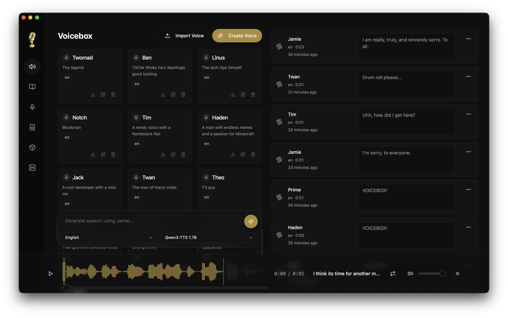

_Voicebox is the open-source, local-first AI voice studio — a free alternative to ElevenLabs and WisprFlow, running entirely on your machine._

Voicebox is the **open-source, local-first AI voice studio** — a free
alternative to ElevenLabs and WisprFlow in one app. Clone voices, generate
speech across 8 TTS engines, dictate into any app with a global hotkey,
compose multi-voice projects, and let any MCP-aware agent speak in a voice
you own. Everything runs on your hardware.

- **Dictation** — hold a chord anywhere on your machine, speak, release; the transcript pastes into the focused field
- **Captures tab** — paired audio + transcript archive, retranscribe / refine / play-as-voice
- **Voice personalities** — per-profile compose button + persona-rewrite toggle, powered by an LLM endpoint you choose
- **Agents speak back** — any MCP-aware agent can call Voicebox to speak in one of your cloned voices
- **8 TTS engines** — Qwen3-TTS, Qwen CustomVoice, Qwen VoiceDesign, LuxTTS, Chatterbox Multilingual, Chatterbox Turbo, HumeAI TADA, Kokoro
- **Cloning and preset voices** — zero-shot cloning or 50+ curated preset voices
- **23 languages** — from English to Arabic, Japanese, Hindi, Swahili
- **Post-processing effects** — pitch shift, reverb, delay, chorus, compression, filters
- **Expressive speech** — paralinguistic tags (`[laugh]`, `[sigh]`) and natural-language delivery control
- **Unlimited length** — auto-chunking with crossfade for long scripts
- **Stories editor** — multi-track timeline for conversations, podcasts, narratives
- **API-first** — REST + WebSocket API, MCP server for agent integrations
- **Complete privacy** — models, audio and transcripts stay on your machine; only the optional LLM endpoint you set sees transcript text
- **Runs on macOS Apple Silicon** — local inference with MLX/Metal

## Download

Get the Apple Silicon DMG from [the latest release](https://github.com/koval-yurko/voicebox/releases/latest).

> [!NOTE]
> The app is not signed or notarized by Apple. After you install it, run
> `xattr -dr com.apple.quarantine "/Applications/Voicebox YK.app"`, or right-click the app and choose **Open**.

## Get Started

- [Installation](Installation) — download and install Voicebox YK
- [Quick Start](Quick-Start) — get up and running in 5 minutes
- [Dictation](Dictation) — start talking to your computer
- [Voice Personalities](Voice-Personalities) — compose and rewrite in any profile
- [API Reference](API) — integrate voice synthesis into your apps

Based on [Voicebox](https://github.com/jamiepine/voicebox) by Jamie Pine (MIT).
